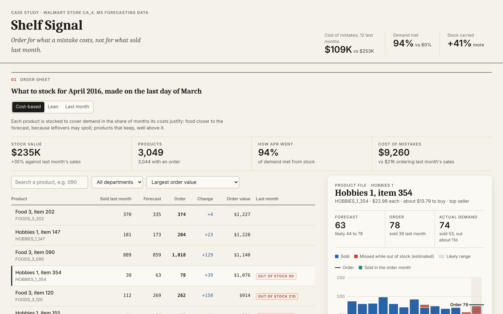
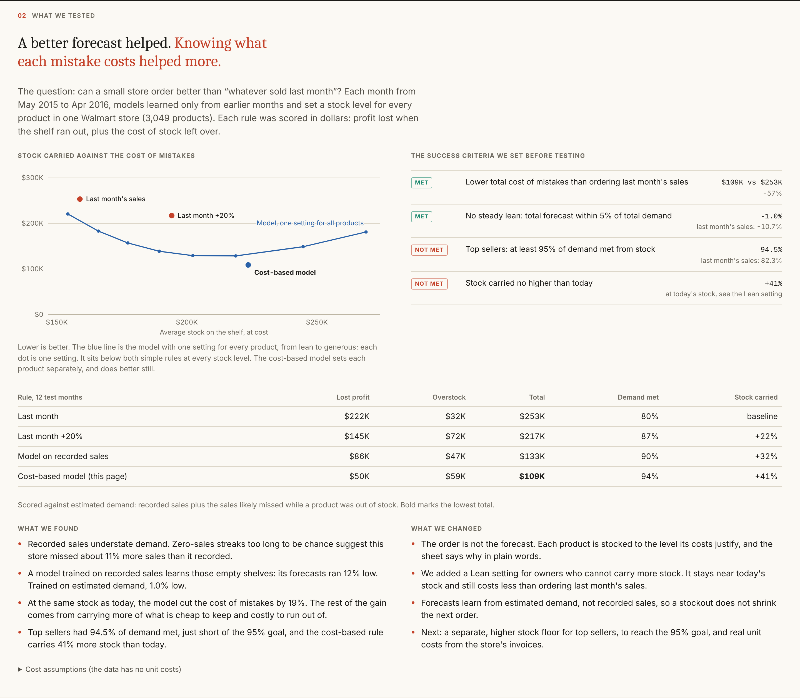

# Shelf Signal

**Order for what a mistake costs, not for what sold last month.**

A product case study: a monthly order sheet for a small store, tested on five years of real sales from one Walmart store (M5 forecasting data, store CA_4, 3,049 products).



## The problem

Once a month, a store owner decides how much of each product to have on the shelf. Most small stores use a rule of thumb: order what sold last month. The rule fails in two ways that cost money:

- **Running out** loses the profit on every missed sale, and the customer may not come back.
- **Overbuying** ties up cash and space, and food may spoil or need a markdown.

The two mistakes do not cost the same. Missing a $10 sale with a 35% margin loses $3.50. A leftover box of batteries costs a few cents a month to keep. A leftover tray of produce may be a total loss.

## Hypotheses

1. A forecast that learns from past sales, the season, prices and the calendar can lower the total cost of mistakes against "order what sold last month".
2. Recorded sales understate demand, because a product sells zero on days the shelf is empty. A forecast trained on recorded sales learns those stockouts and orders too little again.

## What we set as success, before testing

| Goal | Why |
|---|---|
| Lower total cost of mistakes than "order what sold last month" | Otherwise it does not ship |
| Total forecast within 5% of total demand | A steady lean in one direction causes the same mistake every month |
| Top sellers: at least 95% of demand met from stock | These are the products customers come in for |
| Stock carried no higher than today | A small store has limited cash and space |

## How it was tested

- **Estimated demand.** A run of zero-sales days is flagged as a likely stockout when, given how often the product normally has a zero day, a run that long had under a 1% chance of happening by luck. The sales likely missed on those days are added back.
- **Backtest.** For each month from May 2015 to April 2016, models learned only from months already finished, then set a stock level for every product for the next month.
- **Scored in dollars.** Lost profit when demand exceeded stock, plus the cost of stock left over.
- **Order, not forecast.** The stock level is the point on the forecast range that balances the two costs: cost of being short divided by (cost of being short plus cost of extra). Food is stocked closer to the forecast; products that keep are stocked well above it.
- **Cost assumptions.** M5 has no unit costs, so profit margins and leftover costs are assumed per department and stated on the page. They are one line each in `train.py`.

## Results



| Rule, 12 test months | Lost profit | Overstock | Total | Demand met | Stock carried |
|---|---:|---:|---:|---:|---:|
| Order last month's sales | $222K | $32K | $253K | 80% | baseline |
| Last month's sales +20% | $145K | $72K | $217K | 87% | +22% |
| Model trained on recorded sales | $86K | $47K | $133K | 90% | +32% |
| **Cost-based model, trained on estimated demand** | $50K | $59K | **$109K** | 94% | +41% |

| Goal | Result | |
|---|---|---|
| Lower total cost of mistakes | $109K vs $253K (-57%) | Met |
| Total forecast within 5% of demand | -1.0% (last month's sales: -10.7%) | Met |
| Top sellers 95% of demand met | 94.5% (last month's sales: 82.3%) | Not met |
| Stock no higher than today | +41% | Not met |

## What we found

- **Recorded sales understate demand.** In this store, sales likely missed during stockouts add about 11% to recorded sales.
- **Training on recorded sales repeats the stockouts.** That model forecast 12% low; trained on estimated demand, 1.0% low.
- **The forecast is only part of the gain.** At the same stock as today, the model cuts the cost of mistakes by 19%. Most of the rest comes from carrying more of what is cheap to keep and costly to run out of.
- **Two goals were missed.** Top sellers reached 94.5%, just short of 95%, and the cost-based rule carries 41% more stock than today.

## What we changed

| Before | After |
|---|---|
| The order equals the forecast | Each product is stocked to the level its costs justify |
| One answer for every store | A **Lean** setting for owners who cannot carry more stock: it holds stock about level with today (-3%) and still lowers the cost of mistakes by 13% |
| Forecasts learn from recorded sales | Forecasts learn from estimated demand |
| A number with no explanation | Each order lists its reasons in plain words, such as "Likely out of stock for about 9 days last month" |

## Next steps

- A separate stock floor for top sellers, to reach the 95% goal.
- Real unit costs from the store's invoices, in place of the assumed margins.
- Supplier lead times and case sizes, so the stock level becomes an actual purchase order.
- A pilot: run the sheet next to the owner's own orders for three months and compare.

## Run it

1. Get the M5 data (`calendar.csv`, `sell_prices.csv`, `sales_train_evaluation.csv`) from the [M5 Forecasting competition](https://www.kaggle.com/competitions/m5-forecasting-accuracy/data) and put the files in `data/raw/`.
2. Run:

```
pip install pandas pyarrow lightgbm
python3 prep.py --store CA_4
python3 train.py
cd site && python3 -m http.server
```

`train.py` takes about 4 minutes and writes `site/metrics.json` and `site/data.json`.

| File | What it does |
|---|---|
| `prep.py` | Daily sales to monthly, flags likely stockouts, estimates demand |
| `train.py` | Features, backtest, cost scoring, order sheet export |
| `site/index.html` | The order sheet and findings page, no build step |

The M5 data is not included in this repository. It comes from the M5 Forecasting competition (Walmart, University of Nicosia) and is used under its terms.
